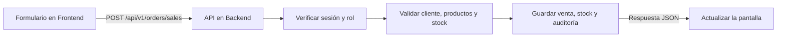

# Conoce tu proyecto Nix

El proyecto tiene dos partes que trabajan juntas: **Frontend** presenta las pantallas y **Backend** procesa y guarda las operaciones. Una pantalla puede pedir una venta, pero el servidor decide si esa venta cumple las reglas.

## 1. Dónde está cada cosa

```text
AWS-ERP/
├── Backend/
│   ├── app/
│   │   ├── main.py          # API, modelos y operaciones principales
│   │   ├── security.py      # Sesiones, usuarios, permisos y perfil
│   │   ├── operations.py    # Edición, ajustes y documentos
│   │   ├── avatars.py       # Fotos de perfil
│   │   └── manage.py        # Administración por terminal
│   ├── tests/
│   │   └── test_flows.py    # Pruebas del comportamiento del ERP
│   ├── database/            # Migraciones versionadas con Alembic
│   ├── requirements.txt
│   ├── enterprisecloud.db   # Base de datos local, no código
│   └── uploads/            # Documentos y fotos, no código
├── Frontend/
│   ├── src/
│   │   ├── main.tsx
│   │   ├── WorkspacePanels.tsx
│   │   ├── AdminPanel.tsx
│   │   ├── UserProfile.tsx
│   │   └── *.css
│   ├── index.html
│   ├── package.json
│   ├── tsconfig.json
│   └── vite.config.ts
├── docs/                    # Documentación y capturas
├── tmp/                     # Temporales e historial de desarrollo
└── README.md                # Instrucciones generales
```

La estructura conserva la implementación actual. Algunos archivos, especialmente `main.tsx` y `main.py`, concentran varias responsabilidades; tener dos carpetas principales no significa que todos los módulos ya estén separados internamente.

## 2. Un ejemplo: registrar una venta



1. En `Frontend/src/main.tsx`, el componente `EntryForm` reúne el cliente y las líneas de productos. Su función `submit` prepara los datos y llama a `send`.
2. `send` usa `fetch` para enviar una solicitud a `/api/v1/orders/sales`. El precio total no se acepta como un valor decidido por el navegador.
3. Durante el desarrollo, `Frontend/vite.config.ts` dirige las solicitudes `/api` al servidor en el puerto 8000.
4. El middleware `authenticate` de `Backend/app/security.py` verifica la sesión y los permisos de escritura.
5. La función `order` de `Backend/app/main.py` valida el cliente, consolida las cantidades y comprueba el stock. Calcula el importe con los precios del catálogo del servidor.
6. SQLAlchemy guarda la venta, los movimientos y la auditoría dentro de una transacción. Si una línea no tiene existencias, la operación se rechaza y no se guardan cambios parciales.
7. El Backend devuelve JSON. `send` vuelve a llamar a `load`, que consulta `/api/v1/workspace`; React actualiza las tablas y los indicadores.

## 3. Conceptos que ya estás utilizando

| Concepto | En tu proyecto |
|---|---|
| Componente | Una función de React que representa una parte de la interfaz, como `UserProfile`. |
| Estado (`useState`) | Datos de la pantalla que pueden cambiar: módulo seleccionado, formulario, tema o registros cargados. |
| Efecto (`useEffect`) | Trabajo que se ejecuta después de un cambio, como consultar una API o guardar una preferencia del menú. |
| API | Rutas del servidor que reciben solicitudes y devuelven datos. |
| JSON | Formato de los datos que intercambian el navegador y el servidor. |
| Esquema Pydantic | Reglas que indican qué campos y valores acepta una solicitud, por ejemplo `OrderIn`. |
| Modelo SQLAlchemy | Representación de los datos guardados; aquí se utilizan `Product` y `Record`. |
| Transacción | Conjunto de cambios que se confirma completo o se revierte. |
| Sesión | Identifica a la persona que inició sesión mediante una cookie privada. |
| Rol | Determina qué operaciones puede realizar esa persona; ocultar un botón es solo una parte del control. |

## 4. Cómo aprender haciendo cambios pequeños

1. **Texto:** busca `Nueva venta` en `Frontend/src/main.tsx`. Cambia el texto de un botón y observa el resultado con Vite iniciado.
2. **Diseño:** localiza una clase en un componente y busca su definición en los archivos CSS. Cambia un espaciado pequeño y observa qué elementos afecta.
3. **Datos:** lee `EntryForm`, luego `send`, y después `order`. Sigue una operación completa en lugar de intentar comprender todos los archivos a la vez.
4. **Reglas:** abre `Backend/tests/test_flows.py` y busca `test_failed_sale_rolls_back_all_lines`. Explica con tus palabras por qué una venta con una línea inválida no debe modificar ningún producto.
5. **Permisos:** compara el filtrado del menú en `main.tsx` con el middleware de `security.py`. La interfaz controla qué se muestra; el servidor controla qué se permite.

Las validaciones del navegador mejoran la experiencia. Las reglas que protegen los datos deben verificarse también en el Backend.

## 5. Trabajar con las dos terminales

Desde la raíz del proyecto, abre una terminal para cada parte:

```powershell
# Terminal del servidor
cd Backend
python -m uvicorn app.main:app --host 127.0.0.1 --port 8000
```

```powershell
# Terminal de la interfaz
cd Frontend
npm run dev
```

El navegador utiliza el puerto 5173. La API utiliza el 8000. Si la interfaz abre pero no carga información, comprueba que la terminal del Backend siga ejecutándose.

Para comprobar un cambio, utiliza `npm run build` dentro de `Frontend` y `python -m unittest discover -s tests -v` dentro de `Backend`. Las pruebas usan datos temporales. Los scripts históricos de `tmp/` no son necesarios para ejecutar ni aprender la aplicación y no deben volver a ejecutarse como pasos de instalación.
